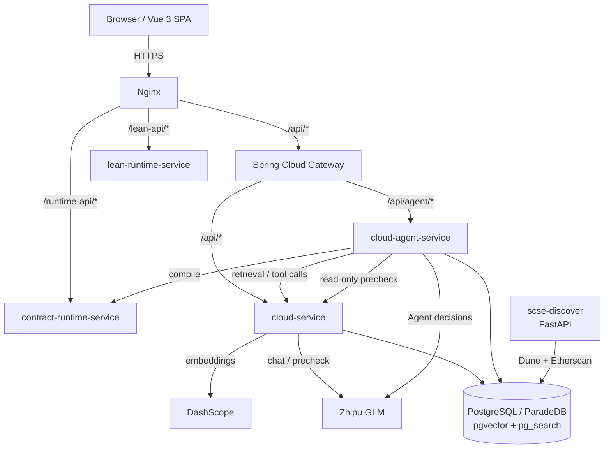

# ContractSearch

AI-powered smart contract retrieval, analysis, and security verification platform.

ContractSearch is an end-to-end platform for finding, understanding, and reusing
Solidity smart contracts. It combines a searchable repository of real on-chain
contracts with an Agentic RAG layer that retrieves evidence, reads source code,
compiles contracts in a sandbox, and runs a read-only security precheck before
producing an answer with traceable sources.

> Development and research project. The system is functional and has been run
> end to end, but it is not a hosted product and some services must currently be
> started manually.

---

## Overview

Reusing a smart contract is not only a search problem. A developer needs to know
whether a candidate match is actually suitable: who can mint tokens, which
access-control model it uses, whether the source is complete, whether it still
compiles, and what its known risks are. Conventional contract repositories stop
at "related results", and a plain chat model cannot inspect a private contract
repository or verify anything it claims.

ContractSearch addresses this by pairing a contract repository and a curated
knowledge base with a bounded Agentic RAG loop. The agent decides what it needs,
retrieves internal data, calls allowlisted tools, observes the real results, and
re-plans if the evidence is insufficient. Final answers are constrained to cite
evidence collected during the run or to abstain.

---

## Key Features

- **Contract repository** - a PostgreSQL/ParadeDB store of real Ethereum
  contracts discovered through Dune and enriched with Etherscan source, ABI, and
  metadata.
- **Hybrid retrieval** - semantic search (DashScope embeddings), BM25 over
  descriptions and source code, and knowledge-chunk text retrieval fused with
  Reciprocal Rank Fusion.
- **Knowledge layer** - contract source is normalized, deduplicated, parsed into
  AST-aware chunks, and stored with file path, line range, symbol, content hash,
  and a trust level. A curated set of authoritative sources (ERC/EIP standards,
  Solidity documentation, OpenZeppelin, OWASP) is versioned and imported
  separately.
- **Iterative Agentic RAG** - a bounded loop where a GLM model re-decides after
  every tool observation, with explicit step, tool-call, and retrieval budgets.
- **Evidence-first answers** - each run records evidence items and only allows a
  final answer to cite evidence that actually exists in that run.
- **Contract Lab** - Solidity compilation, in-memory EVM sandbox deployment and
  function calls, plus optional Lean 4 proof checking.
- **Security precheck** - a read-only analysis combining deterministic Solidity
  heuristics with a GLM pass, exposed both as a standalone page and as an agent
  tool.
- **Developer web UI** - Vue 3 single-page application with browse, search,
  contract detail, AI conversation, security precheck, and Contract Lab views.

---

## Architecture



Request topology:

```text
Browser
  -> Nginx
       /api/*        -> Gateway :18080 -> cloud-service :18081
       /api/agent/*  -> Gateway :18080 -> cloud-agent-service :18082
       /runtime-api/* -> contract-runtime-service :19090
       /lean-api/*    -> lean-runtime-service :19100
```

For a detailed component breakdown see
[`docs/architecture/overview.md`](docs/architecture/overview.md).

---

## AI / Agent Workflow

The agent is implemented as a Java/Spring Boot control plane
(`backend/cloud-agent-service`) rather than a separate Python runtime, so it
reuses the existing Spring Security, Gateway, and MyBatis/Flyway stack.

1. **Task intake** - the user asks a question in the AI conversation view. The
   request creates an agent run and returns immediately; the UI polls the run
   snapshot and streams activity.
2. **Planning** - the GLM model receives the task, a bounded tool catalog, and
   the current run state, and returns one structured action.
3. **Action** - the action is validated against the tool allowlist, JSON
   argument rules, and the run budget. Tools are read-only or sandboxed:
   - `retrieve_knowledge.v1` - hybrid retrieval over knowledge chunks
   - `search_contracts.v1` - search the contract repository
   - `get_contract.v1` - read source, ABI, and metadata for one contract
   - `compile_contract.v1` - compile source in the isolated runtime
   - `precheck_contract.v1` - read-only AI security precheck
4. **Observation and re-planning** - tool output is normalized into evidence and
   fed back to the model, which decides whether to retrieve more, read source,
   verify, or answer.
5. **Synthesis** - the final answer may only cite evidence created in the run. If
   the evidence is insufficient, the run ends without a definitive answer.

Bounds and guardrails:

- Maximum 6 model decisions, 5 tool calls, and 2 retrieval rounds per run.
- Identical tool calls are detected; the first repeat is skipped and the model
  must use existing evidence, only a second repeat terminates the run.
- Retrieved text, contract comments, and user input are wrapped as untrusted
  data and cannot modify system instructions, tool permissions, or budgets.
- The agent cannot use shell, arbitrary URLs, the filesystem, raw database
  access, or any persistent write. Contract deployment and calling are not
  exposed to the agent loop.
- Lean 4 is available in Contract Lab but intentionally kept out of the default
  agent toolset, because checking a hand-written Lean model is not a proof that
  the original Solidity is equivalent.

---

## Tech Stack

| Layer | Technologies |
|---|---|
| Frontend | Vue 3, Vite, Vue Router, Pinia, Axios, Monaco Editor |
| API gateway | Spring Cloud Gateway, JWT |
| Backend services | Spring Boot 3.5, Spring Cloud 2025, Spring Cloud Alibaba, MyBatis-Plus, Flyway |
| Service discovery | Nacos (optional, single-server deployments use static routing) |
| Database / search | PostgreSQL 18, ParadeDB `pg_search`, `pgvector`, `tsvector`/GIN |
| AI | Zhipu GLM (chat, agent decisions, precheck), DashScope embeddings (768-dim) |
| Runtime tools | Node.js, Express, solc 0.8.35, ethers 6, Ganache (in-memory EVM), Lean 4 |
| Data ingestion | Python, FastAPI, Dune Analytics, Etherscan v2 |
| Deployment | Nginx, systemd (single Ubuntu server) |

---

## Screenshots

No product screenshots are committed yet. Add 3-5 images under
`docs/screenshots/` and reference them here. Recommended set:

1. Contract browse / repository view
2. Hybrid search and result cards
3. AI conversation showing streamed agent activity and expandable sources
4. Contract detail with source and ABI
5. Security precheck or Contract Lab

Do not add mockups in place of real UI captures.

---

## Project Structure

```text
backend/
  cloud-gateway/          API gateway, JWT validation, internal-token injection
  cloud-service/          Contracts, search, users, favorites, drafts, precheck, legacy AI chat
  cloud-agent-service/    Agent loop, tools, RAG, evidence, run persistence
  cloud-auth-service/     Reserved standalone auth module (not required to run)
  cloud-user-service/     Reserved standalone user module (not required to run)
frontend/                 Vue 3 + Vite single-page application
scse-discover/            Offline contract discovery and ingestion (FastAPI)
contract-runtime-service/ Solidity compile / sandbox deploy / call (Node)
lean-runtime-service/     Lean 4 proof checking (Node)
docs/                     Architecture, deployment, knowledge, and ADR documentation
scripts/                  Knowledge sync, probes, and evaluation harness
```

`database/` and `backups/` are intentionally excluded from version control; see
[Data and licensing](#data-and-licensing).

---

## Getting Started

### Prerequisites

- Java 17 and Maven 3.9+
- Node.js 20+ and npm
- PostgreSQL with the `vector` and `pg_search` extensions (ParadeDB)
- Zhipu GLM API key and a DashScope API key
- Python 3.10+ (only for the discovery / ingestion script)
- Lean 4 (only for the Lean proof-check feature)

The repository currently requires several local services to run. There is no
single-command startup, and no Docker Compose file covers the full platform yet.

### 1. Database

Create a database and enable the required extensions, then restore a seed or
build the contract data with the discovery service. Apply the agent migrations
in `backend/cloud-agent-service/src/main/resources/db/migration/` (Flyway V1-V6)
by temporarily setting `AGENT_MIGRATIONS_ENABLED=true` for a single agent
instance.

### 2. Backend

```bash
cd backend
mvn -DskipTests clean package

java -jar cloud-service/target/cloud-service-1.0-SNAPSHOT.jar
java -jar cloud-agent-service/target/cloud-agent-service-1.0-SNAPSHOT.jar
java -jar cloud-gateway/target/cloud-gateway-1.0-SNAPSHOT.jar
```

### 3. Runtime services

```bash
cd contract-runtime-service && npm ci && npm start   # :19090
cd lean-runtime-service && npm ci && npm start       # :19100
```

### 4. Frontend

```bash
cd frontend
cp .env.example .env
npm ci
npm run dev        # http://localhost:5173
```

### Startup order

PostgreSQL -> `cloud-service` -> runtime services -> `cloud-agent-service` ->
`cloud-gateway` -> frontend.

---

## Configuration

All credentials are provided through environment variables. Copy `.env.example`
to `.env` and fill in real values; a filled `.env` is ignored by Git and must
never be committed.

Key variables:

| Variable | Purpose |
|---|---|
| `JWT_SECRET` | JWT signing secret |
| `AGENT_INTERNAL_TOKEN` | Shared gateway-to-agent token (>= 24 chars) |
| `ZHIPU_API_KEY` | GLM chat, agent decisions, security precheck |
| `DASHSCOPE_API_KEY` | Embedding generation for semantic search |
| `SPRING_DATASOURCE_URL` / `POSTGRESQL_DB_*` | Main database connection |
| `AGENT_*` | Agent activation, model, budgets, persistence, knowledge layer |

Spring services read these through `${VAR:default}` placeholders in
`application.yml`. The Node runtimes and the Python service read their own
environment (see `scse-discover/.env.example`).

---

## Development / Status

This is an active development and research project. The contract repository,
knowledge layer, hybrid retrieval, agent loop, evidence persistence, and web UI
are implemented and have been exercised end to end. The precheck and Contract
Lab features work independently of the agent.

Known limitations are tracked in `docs/agentic-rag/current-state.md` and the
delivery reports in `docs/agentic-rag/reports/`. Examples include single-file
compilation in the runtime service and a reserved (not yet active) standalone
auth/user module.

Development notes and the full delivery plan are kept outside the public
repository. Deployment instructions are in
`docs/deployment-guide.zh-CN.md` (Chinese).

---

## Data and Licensing

- The repository does **not** include the database dump, seed SQL, generated
  Parquet files, or backups. These are large and contain third-party contract
  source and documentation. They are excluded via `.gitignore`.
- Authoritative knowledge sources are recorded as a fixed manifest with URLs,
  versions, and content hashes in `docs/agentic-rag/knowledge-sources-v1.json`.
  Their upstream licenses (for example OpenZeppelin MIT, OWASP content) apply to
  the sourced content, not to this repository's code.
- No open-source license has been added to this repository yet, pending a final
  ownership and licensing decision. Until then, all rights are reserved by the
  author.

---

## Author

Developed and maintained by Tang Jin.

---

## Documentation

- [`docs/architecture/overview.md`](docs/architecture/overview.md) - component and data-flow overview
- [`docs/agentic-rag/current-state.md`](docs/agentic-rag/current-state.md) - verified environment and system state
- [`docs/agentic-rag/service-map.md`](docs/agentic-rag/service-map.md) - service ownership
- [`docs/agentic-rag/api-inventory.md`](docs/agentic-rag/api-inventory.md) - existing APIs and agent reuse map
- [`docs/agentic-rag/adr/`](docs/agentic-rag/adr/) - architecture decision records
- [`docs/agentic-rag/reports/`](docs/agentic-rag/reports/) - delivery stage reports
- [`docs/deployment-guide.zh-CN.md`](docs/deployment-guide.zh-CN.md) - single-server deployment guide (Chinese)
