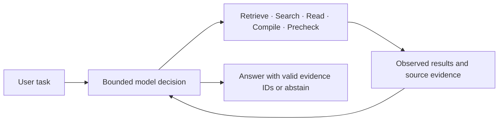
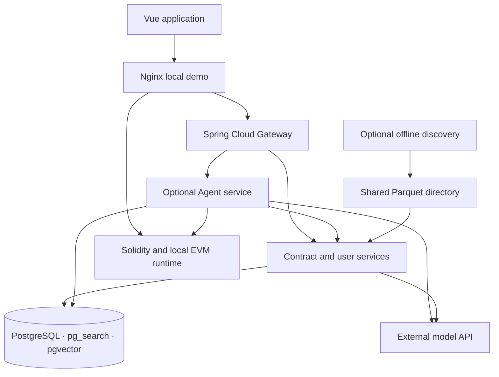

# ContractSearch

[](https://github.com/jintangme/ContractSearch/actions/workflows/ci.yml)

**An evidence-driven workspace for finding, understanding, and experimenting with Solidity contracts.**

[中文说明](README.zh-CN.md) · [Quick start](docs/development/quickstart.md) · [Architecture](docs/architecture/overview.md) · [Validation](docs/evaluation/README.md) · [Third-party notices](THIRD_PARTY_NOTICES.md)

ContractSearch 2.0 connects contract search with a bounded Agentic RAG workflow.
Users can inspect candidate source code, follow an answer's evidence, and compile
and exercise small contracts in a local EVM. The repository includes a small,
synthetic demonstration dataset so the basic workflow can run without model API keys.


*Actual application running against the included demonstration environment. The
demo contracts and account are synthetic; this image is not an Agent evaluation.*

## What the project implements

| Capability | Implementation |
|---|---|
| Contract retrieval | ParadeDB BM25 over source/descriptions; optional description embeddings; Reciprocal Rank Fusion |
| Knowledge ingestion | Source-format normalization, content deduplication, AST-aware chunks with lexical fallback, checkpointed ingestion |
| Agent orchestration | Java control plane; observation/replanning loop; five allowlisted tools; step and retrieval budgets |
| Evidence tracking | Per-run evidence IDs, file/line provenance, content hashes, trust labels, citation existence validation |
| Contract workspace | Monaco editor, Solidity compilation, local Ganache deployment and function calls |
| Developer workflow | Browse, search, contract detail, conversations, precheck, favorites, and saved drafts |

The project's engineering focus is the integration of retrieval, source
provenance, bounded tool execution, and an inspectable user workflow. Compilers,
database engines, editors, and model inference are provided by the components
and services listed in [Third-party notices](THIRD_PARTY_NOTICES.md).

## Try the basic demo

Requirements: Docker with Compose v2, Python 3.10+, and access to dependency
registries for the first build. No production database or API key is needed.

```bash
git clone https://github.com/jintangme/ContractSearch.git
cd ContractSearch
python3 scripts/configure-demo.py
docker compose up --build -d
python3 scripts/smoke-demo.py
```

Open **http://localhost:8080**, register a disposable local account (an
`example.com` email is sufficient), and try:

1. Search source code for `owner` or browse the demo collection.
2. Open a contract to inspect its source and ABI.
3. Send it to Contract Lab, compile it, then deploy and call it in the local EVM.

The configuration helper generates fresh local secrets without printing them
and refuses to overwrite an existing configuration. Ports are bound to
loopback. The demo uses a dedicated database volume; ordinary `docker compose
down` keeps it.

See [the full quick start](docs/development/quickstart.md) for host development,
startup checks, and explicitly enabling Agent mode.

## Agent workflow



The default loop allows six model decisions, five tool calls, and two retrieval
rounds. The model observes tool results before deciding again. Tools have
validated arguments and fixed service destinations; deployment, filesystem
access, shell execution, and Lean are outside the Agent toolset.

The curated reference manifest pins ERC/EIP, Solidity, OpenZeppelin, and OWASP
materials to upstream revisions. Reference material and retrieved code are
treated as data with explicit trust labels.

Agent mode needs provider credentials and knowledge ingestion. The basic demo
does not simulate Agent answers. See [Agent setup](docs/development/agent-mode.md).

## System layout



| Directory | Responsibility |
|---|---|
| `backend/` | Gateway, business service, Agent service; optional reserved modules |
| `frontend/` | Vue UI, extracted workspace modules, evidence presentation |
| `contract-runtime-service/` | solc, AST extraction, shared in-memory Ganache runtime |
| `lean-runtime-service/` | Optional local Lean source checking |
| `scse-discover/` | Optional Dune/Etherscan discovery and protected import callback |
| `database/bootstrap/` | Fresh demo schema and three original example contracts |
| `deploy/` | Container builds and loopback-only demo proxy |
| `docs/` | Architecture, development, evaluation, reference, and historical records |
| `scripts/` | Configuration, smoke checks, publication checks, knowledge tools |

## Validation and boundaries

Executable checks cover the Agent control loop, trust boundaries, runtime
compilation/deployment/calls, frontend state and evidence handling, and the basic
demo APIs. Exact results and commands are recorded in
[Validation](docs/evaluation/README.md); CI is defined in
[`.github/workflows/ci.yml`](.github/workflows/ci.yml).

- Citation validation checks that evidence exists in a run. It does not prove
  that every generated claim is entailed by that evidence.
- Security precheck combines source heuristics and model assistance. It is not
  a security audit or a guarantee that a contract is safe.
- Lean checks a submitted Lean file. No Solidity-to-Lean equivalence proof is
  implemented; the checker is excluded from the demo proxy.
- The EVM is shared and local. It is not a production multi-tenant execution service.
- Running Agent tasks live in memory; optional persistence archives completed
  sessions, runs, events, and evidence. It does not resume interrupted execution.
- Historical mock evaluation rows test the evaluation harness, not model quality.
- The bundled sample has no precomputed embeddings. It supports basic code
  search; semantic retrieval requires provider configuration and suitable data.

See [current status](docs/status.md) and [version evolution](docs/version-history.md).

## Data, attribution, and privacy

The demo contains no real user accounts, conversation histories, production
dumps, or provider credentials. The original private dataset and backups are
excluded. Knowledge sources retain their own licenses and provenance; see
[data sources](docs/reference/data-sources.md).

No **repository-wide license** has been selected. Existing file and snippet
license markers remain in place and require source-specific review; the new
database examples are marked `UNLICENSED`. Third-party software and content
remain subject to their own terms. See
[Third-party notices](THIRD_PARTY_NOTICES.md) and [security guidance](SECURITY.md).

For a reviewed source snapshot without Git history, run
`python3 scripts/export-public-source.py` from the checkout. The resulting ZIP
is kept under ignored `artifacts/`; it does not clean an existing remote history.

Maintained by [jintangme](https://github.com/jintangme).
