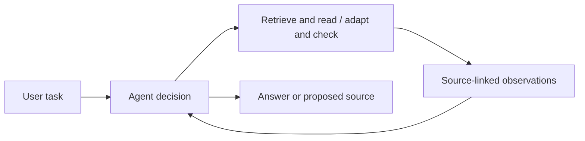

# ContractSearch

[](https://github.com/jintangme/ContractSearch/actions/workflows/ci.yml)

**The blockchain engineer’s toolkit for smart contract discovery and reuse.**

**English** · [简体中文](README.zh-CN.md)

ContractSearch brings contract retrieval, source inspection, AI-assisted precheck,
and a Solidity workspace into one platform. Developers can find relevant contracts,
understand their implementation, adapt source code, and check its behavior in a
local EVM. AgenticRAG supports this workflow with source-backed answers and tools
selected according to the task.


*The application running with the included demonstration contracts.*

## Features

| Capability | What it provides |
|---|---|
| Search and browse | Source and description BM25 search, optional semantic retrieval, and Reciprocal Rank Fusion |
| Source inspection and precheck | Contract source, ABI, source references, and heuristic/model-assisted checks |
| AgenticRAG | Task-dependent retrieval, source reading, reuse planning, compilation, candidate validation, and optional review |
| Contract Lab | Monaco editing, Solidity compilation, local deployment, and function calls |
| Lean checking | Optional checking of user-supplied Lean files and proof models |
| Reuse workflow | Conversations, profiles, favorites, folders, drafts, and contract submissions |

## Quick start

Requirements: Docker with Compose v2, Python 3.10+, and network access for the
initial dependency downloads. The basic demo includes three small example
contracts and runs without model API keys.

```bash
git clone https://github.com/jintangme/ContractSearch.git
cd ContractSearch
python3 scripts/configure-demo.py
docker compose up --build -d
python3 scripts/smoke-demo.py
```

Open **http://localhost:8080**, register a local account using an example email,
and try the following:

1. Browse the sample contracts or search source code for `owner`.
2. Open a contract to inspect its source and ABI.
3. Open Contract Lab, compile the source, deploy it locally, and call a function.

The configuration helper generates local secrets and preserves existing settings.
Published ports listen on localhost. `docker compose down` stops the stack and
keeps its database volume.

For host development, see the [quick-start guide](docs/development/quickstart.md).
To enable real model calls and knowledge retrieval, follow
[Agent setup](docs/development/agent-mode.md).

## How AgenticRAG works



The model chooses its next action from the tools currently available and can
finish when sufficient evidence has been collected. Source-editing tasks can
use a structured reuse plan, compile candidate code, and run planned checks in
a disposable EVM worker. Results are associated with source hashes so evidence
from a different candidate cannot be reused as validation of the final code.

The Java controller enforces tool permissions, argument validation, and call
budgets. It attempts final-source compilation within the remaining budget and
records the actual status. Optional review is invoked when selected; requests
do not have to traverse the same fixed sequence.

See the [system architecture](docs/architecture/overview.md) and
[Agent service documentation](backend/cloud-agent-service/README.md) for details.

## Repository structure

| Directory | Contents |
|---|---|
| `frontend/` | Vue application and Contract Lab UI |
| `backend/` | Spring services, authentication, retrieval, and Agent orchestration |
| `contract-runtime-service/` | Solidity compilation and local EVM tools |
| `lean-runtime-service/` | Optional Lean checker |
| `scse-discover/` | Optional Dune/Etherscan discovery and import service |
| `database/bootstrap/` | Database schema and demonstration contracts |
| `deploy/` | Container builds and local reverse proxy |
| `docs/` | Setup, architecture, API contracts, testing, and data sources |
| `scripts/` | Configuration, knowledge import, smoke checks, and source checks |

## Development

Java 17, Maven 3.9+, and Node.js 22 are used for host development.

```bash
mvn -f backend/pom.xml test
npm --prefix frontend test
npm --prefix frontend run build
npm --prefix contract-runtime-service test
npm --prefix lean-runtime-service test
python3 -m unittest discover -s scripts/tests -v
```

Install each Node service’s dependencies with `npm ci` before running its checks.
See [testing](docs/evaluation/README.md) for coverage and optional integration
tests, and [contributing](CONTRIBUTING.md) for the contribution workflow.

## Scope and licensing

The supplied stack is intended for local development and demonstration. Precheck,
successful compilation, and passing scenarios do not establish contract security.
Lean checks supplied Lean programs; it does not prove Solidity-to-Lean equivalence.
See [security guidance](SECURITY.md) before changing the deployment boundary.

The repository includes synthetic demonstration data. Retrieved contracts and
reference materials retain their own licenses and provenance; see
[data sources](docs/reference/data-sources.md) and
[third-party notices](THIRD_PARTY_NOTICES.md). A repository-wide license has not
yet been selected.
