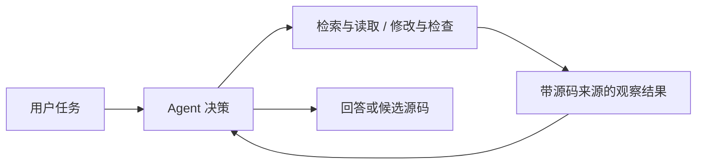

# ContractSearch

[](https://github.com/jintangme/ContractSearch/actions/workflows/ci.yml)

**区块链工程师的百宝箱：面向智能合约发现与复用的一体化工具平台。**

[English](README.md) · **简体中文**

ContractSearch 将合约检索、源码查看、AI 辅助预审与 Solidity 工作台集成到同一平台。
开发者可以发现合适的合约、理解实现、修改源码，并在本地 EVM 中检查其行为。
AgenticRAG 根据任务选择工具，为这一流程提供可追溯来源的回答与执行支持。


*使用仓库自带示例合约运行的实际界面。*

## 核心能力

| 能力 | 功能 |
|---|---|
| 检索与浏览 | 源码及描述 BM25 检索、可选语义检索，以及 RRF 排名融合 |
| 源码查看与预审 | 合约源码、ABI、来源引用，以及规则与模型辅助检查 |
| AgenticRAG | 按任务选择检索、源码读取、复用规划、编译、候选验证与可选复核 |
| 合约工作台 | Monaco 编辑、Solidity 编译、本地部署与函数调用 |
| Lean 检查 | 可选检查用户提供的 Lean 文件及证明模型 |
| 复用流程 | 对话、个人主页、收藏、文件夹、草稿与合约提交 |

## 快速开始

需要 Docker（含 Compose v2）、Python 3.10+，以及首次下载依赖所需的网络。
基础演示包含三份小型示例合约，无需配置模型 API Key。

```bash
git clone https://github.com/jintangme/ContractSearch.git
cd ContractSearch
python3 scripts/configure-demo.py
docker compose up --build -d
python3 scripts/smoke-demo.py
```

打开 **http://localhost:8080**，使用示例邮箱注册本地账号，然后：

1. 浏览示例合约，或在源码搜索中查询 `owner`。
2. 打开合约详情，查看源码与 ABI。
3. 进入合约工作台，编译源码、本地部署并调用函数。

配置脚本会生成本地密钥，并保留已有配置。映射端口仅监听本机。
`docker compose down` 停止服务，同时保留数据库卷。

本机开发步骤见[运行指南](docs/development/quickstart.md)。
启用真实模型调用和知识检索，请参阅 [Agent 配置](docs/development/agent-mode.md)。

## AgenticRAG 如何工作



模型从当前可用的工具中选择下一步动作，并在证据充分时结束。
源码修改任务可以使用结构化复用计划、候选源码编译，以及在一次性 EVM 工作进程中执行的计划检查。
检查结果与源码哈希关联，避免将其他候选版本的结果作为最终代码的验证依据。

Java 控制层负责工具权限、参数校验与调用预算，并在剩余预算内尝试最终源码编译、记录实际状态。
复核按需调用，各类任务不必经过同一套固定流程。

更多细节见[系统架构](docs/architecture/overview.md)和
[Agent 服务文档](backend/cloud-agent-service/README.md)。

## 仓库结构

| 目录 | 内容 |
|---|---|
| `frontend/` | Vue 应用与合约工作台界面 |
| `backend/` | Spring 服务、身份认证、检索与 Agent 编排 |
| `contract-runtime-service/` | Solidity 编译与本地 EVM 工具 |
| `lean-runtime-service/` | 可选 Lean 检查服务 |
| `scse-discover/` | 可选 Dune/Etherscan 数据发现与导入服务 |
| `database/bootstrap/` | 数据库结构与示例合约 |
| `deploy/` | 容器构建与本地反向代理 |
| `docs/` | 配置、架构、API 契约、测试与数据来源 |
| `scripts/` | 配置、知识导入、冒烟测试与源码检查 |

## 开发

本机开发使用 Java 17、Maven 3.9+ 和 Node.js 22。

```bash
mvn -f backend/pom.xml test
npm --prefix frontend test
npm --prefix frontend run build
npm --prefix contract-runtime-service test
npm --prefix lean-runtime-service test
python3 -m unittest discover -s scripts/tests -v
```

运行检查前，在对应 Node 服务目录执行 `npm ci` 安装依赖。
覆盖范围与可选集成测试见[测试说明](docs/evaluation/README.md)，
贡献流程见[贡献指南](CONTRIBUTING.md)。

## 使用范围与许可

仓库提供的运行环境用于本地开发和演示。预审、编译成功及场景测试通过均不代表合约安全。
Lean 检查针对提供的 Lean 程序，不证明其与 Solidity 源码等价。
调整部署边界前，请参阅[安全说明](SECURITY.md)。

仓库包含合成示例数据。检索得到的合约与参考资料保留各自的许可和来源信息，详见
[数据来源](docs/reference/data-sources.md)与[第三方声明](THIRD_PARTY_NOTICES.md)。
仓库级许可证尚未确定。
