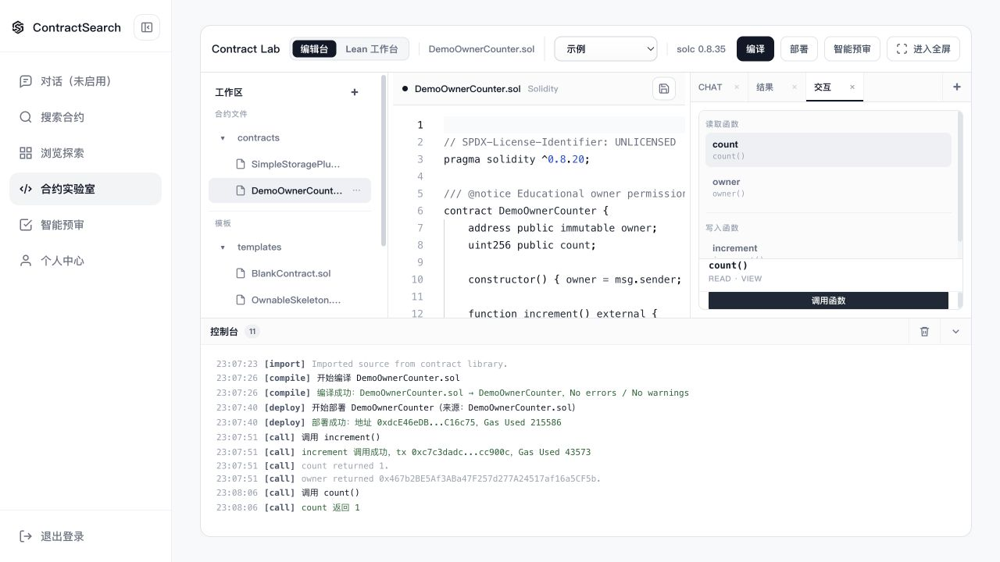

# ContractSearch

**面向 Solidity 合约检索、理解与实验的证据驱动工作台。**

[English](README.md) · [运行指南](docs/development/quickstart.md) · [系统架构](docs/architecture/overview.md) · [验证记录](docs/evaluation/README.md) · [第三方说明](THIRD_PARTY_NOTICES.md)

ContractSearch 2.0 将合约检索、有界 Agent 工具调用、来源证据与合约实验室串联起来。
用户可以查看候选合约源码、追溯回答来源，并在本地 EVM 中编译、部署与调用小型合约。
仓库提供三份自写示例合约，用于不依赖模型密钥的基础演示。



*截图来自实际运行的基础演示环境，账号与合约均为示例数据，不代表 Agent 效果评测。*

## 核心能力

- **混合检索**：源码/描述 BM25、可选描述向量检索与 RRF 融合。
- **知识处理**：源码归一化、内容去重、AST 优先切分与词法回退、可恢复的批次导入。
- **Agent 编排**：Java 控制服务在每次工具观察后重新决策，限制工具、步骤与检索预算。
- **证据管理**：记录本次运行的证据 ID、文件/行号、内容哈希和可信度，并验证引用是否存在。
- **合约实验室**：Monaco 编辑器、Solidity 编译、本地 Ganache 部署与函数调用。
- **业务流程**：浏览、搜索、详情、AI 对话、预审、收藏与草稿。

项目的主要实现贡献集中在检索组合、知识来源管理、Agent 控制逻辑及完整业务流程。
编辑器、数据库、编译器和模型推理由对应第三方组件与服务提供，详见
[第三方组件清单](docs/reference/third-party-components.md)。

## 快速运行

需要 Docker（含 Compose v2）、Python 3.10+，以及首次构建时访问依赖仓库的网络。
基础模式不需要模型 API Key，也不依赖原来的私有数据库。

```bash
git clone https://github.com/jintangme/ContractSearch.git
cd ContractSearch
python3 scripts/configure-demo.py
docker compose up --build -d
python3 scripts/smoke-demo.py
```

打开 **http://localhost:8080**，注册本地演示账号（可使用 `example.com` 示例邮箱）：

1. 在代码搜索中查询 `owner`，或浏览示例合约组。
2. 打开详情查看源码与 ABI。
3. 进入合约实验室，完成编译、部署和函数调用。

配置脚本会生成随机本地密钥，不打印其内容，也不会覆盖已有配置。
所有映射端口仅监听本机；`docker compose down` 保留示例数据库。

完整步骤见[运行指南](docs/development/quickstart.md)。
[Agent 模式](docs/development/agent-mode.md)需要单独配置模型服务和知识导入；
基础模式不会生成模拟 Agent 回答。

## 2.0 的设计重点

用户问题进入 Agent 后，模型从检索知识、搜索合约、读取源码、编译和只读预审
五种工具中选择动作。每次执行得到的结果会成为证据，并用于下一轮决策。
默认预算为六次模型决策、五次工具调用、两轮检索；最终回答引用当前运行中的有效证据，
或明确表示证据不足。

知识参考来源通过固定上游版本记录，合约源码和参考文本均以数据形式处理。
[架构说明](docs/architecture/overview.md)解释服务边界、数据流和设计取舍。

## 工程验证与限制

当前可执行检查覆盖 Agent 行为、身份与导入边界、真实编译/部署/调用、前端状态和来源交互、
基础演示 API。具体命令、结果与验证范围见[验证记录](docs/evaluation/README.md)。

- 引用存在性校验不等于回答逐句正确性证明。
- 智能预审采用启发式规则与模型辅助，不构成安全审计。
- Lean 功能只检查提交的 Lean 文件，尚未建立 Solidity 等价性证明；演示代理不开放该服务。
- Ganache 是共享的本地内存链，不是面向多租户的执行平台。
- Agent 持久化用于终态历史归档，不支持中断任务的自动续跑。
- 历史 mock 评测用于检查评测框架，不能作为模型效果优越性的证据。
- 示例数据不含预计算向量，语义检索需要额外配置和数据准备。

[当前状态](docs/status.md) · [1.0 与 2.0 的演进](docs/version-history.md)

## 数据与许可

公开示例不包含真实账号、历史对话、生产数据库或 API 密钥。原始数据备份和本地资料
保持排除状态；第三方合约与知识材料按各自来源记录，见[数据来源说明](docs/reference/data-sources.md)。

仓库级开源许可证尚未确定，当前按公开源码项目展示。已有文件和代码片段的许可标识予以保留，仍需逐项核对来源；新数据库示例标为 `UNLICENSED`。
第三方组件和材料保留原有许可，详见[第三方声明](THIRD_PARTY_NOTICES.md)。

需要不含 Git 历史的源码快照时，在仓库内运行 `python3 scripts/export-public-source.py`。
脚本先检查当前公开候选文件，再输出到被忽略的 `artifacts/ContractSearch-source.zip`。
它不会清除远程仓库已有的历史记录，发布前仍需审阅。
公开发布前的检查方法见[安全与隐私说明](SECURITY.md)。

维护者：[jintangme](https://github.com/jintangme)。
