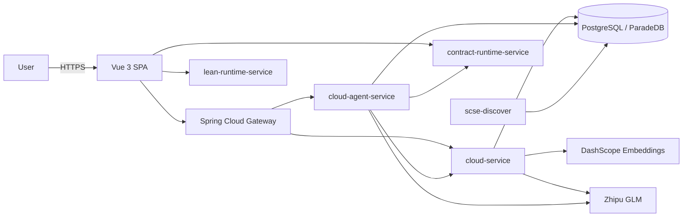
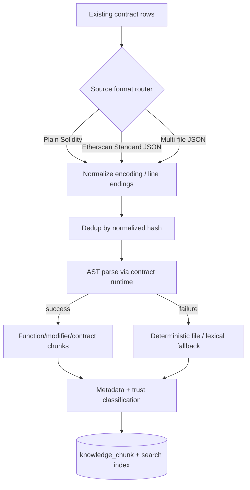

# Architecture Overview

> This document describes the components as they exist in the repository. It is
> a reference for reviewers and for future development, not a specification of
> an idealized system.

## 1. System context

ContractSearch is a web platform that lets users search a repository of real
smart contracts, inspect their source, and run AI-assisted analysis and
verification. It is composed of a Vue single-page application, a set of Spring
Boot services behind a Spring Cloud Gateway, two small Node runtimes for
Solidity and Lean execution, and a Python ingestion utility.



## 2. Services

| Service | Runtime | Port | Responsibility |
|---|---|---:|---|
| `cloud-gateway` | Spring Boot | 18080 | Single API entry. Validates JWT, removes a caller-supplied `X-User-Id`, injects the trusted user id and the internal agent token, routes to backend services. |
| `cloud-service` | Spring Boot | 18081 | Main business logic: contracts, groups, search, users, favorites, drafts, uploads, AI chat, AI precheck. Also calls DashScope for embeddings. |
| `cloud-agent-service` | Spring Boot | 18082 | Agent control plane: run/session lifecycle, state machine, bounded loop, tool registry and policy, knowledge retrieval, evidence, persistence. |
| `contract-runtime-service` | Node/Express | 19090 | Solidity compilation (solc 0.8.35), AST metadata extraction for ingestion, in-memory Ganache sandbox deploy and calls. |
| `lean-runtime-service` | Node/Express | 19100 | Runs the Lean compiler on submitted Lean source and returns structured diagnostics. Does not prove Solidity equivalence. |
| `scse-discover` | Python/FastAPI | 18000 | Offline discovery: Dune queries plus Etherscan enrichment into Parquet, then a callback into `cloud-service`. |
| `frontend` | Vue 3 / Vite | 5173 dev | SPA: browse, search, contract detail, AI conversation, security precheck, Contract Lab, profile. |
| `cloud-auth-service` / `cloud-user-service` | Spring Boot | - | Reserved modules. Not part of the running topology and not required to start the system. |

## 3. Data model

The platform uses a single PostgreSQL/ParadeDB database with the `vector` and
`pg_search` extensions.

- **Application tables** (`public` schema): `smart_contract`, `user_contract_record`,
  `ai_chat_session`, `ai_chat_message`, `ai_chat_attachment`, `group`, favorites,
  uploads, check records.
- **Agent tables** (Flyway V1, V6): `agent_session`, `agent_run`, `agent_event`,
  `agent_evidence`, `agent_proposal`.
- **Knowledge tables** (Flyway V2-V5): `knowledge_corpus_version`,
  `knowledge_source`, `knowledge_document`, `knowledge_chunk`,
  `knowledge_source_alias`, `knowledge_ingestion_job`,
  `knowledge_ingestion_item`, `knowledge_ingestion_error`,
  `knowledge_chunk_search`.

Each knowledge chunk stores its document, optional parent chunk, chunk kind,
symbol and signature, heading path, display and embedding text, line range,
trust level, evidence class, context role, content hash, chunker version, and an
optional embedding. The `knowledge_chunk_search` table holds the text-search
projection used by the retrieval channel.

## 4. Knowledge ingestion



Authoritative documentation (ERC/EIP standards, Solidity documentation,
OpenZeppelin references, OWASP) is imported from a fixed manifest
(`docs/agentic-rag/knowledge-sources-v1.json`) that pins source URL, version or
commit, license, and content hash. Import is idempotent for the same
source/version/content hash.

## 5. Retrieval

- **Semantic channel** - DashScope `text-embedding-v4`, truncated to 768
  dimensions to match the existing `vector(768)` columns and the HNSW indexes.
- **Keyword channel** - ParadeDB BM25 over descriptions and source code.
- **Chunk text channel** - PostgreSQL `tsvector`/GIN over knowledge chunks.
- **Authoritative reference channel** - source-key and coverage matching for
  standards and library references.

Channels are fused with Reciprocal Rank Fusion (`k = 60`). Retrieval returns the
per-channel ranks, fusion score, trust level, source reference, and line span so
results remain explainable and can be degraded channel by channel.

## 6. Agent control plane

Package layout in `cloud-agent-service`:

```text
config/         properties, startup validation, execution thread pool
controller/     run, knowledge retrieval, knowledge ingestion endpoints
domain/         run state, events, evidence, side effects, trust levels
knowledge/      source routing, AST chunking, stores, retrieval
migration/      Flyway runner gated by AGENT_MIGRATIONS_ENABLED
security/       internal-token filter
service/        mini loop engine, structured action provider, run archive
state/          state machine and transition rules
tool/           tool interface, registry, policy, argument validation, tools
observability/  trace id filter
```

State machine (implemented in `domain/AgentRunState` and `state/AgentStateMachine`):

```text
RECEIVED -> PLAN -> TOOL_CALL -> OBSERVE -> PLAN ...
                        OBSERVE -> SYNTHESIZE -> COMPLETE
any non-terminal -> FAILED
```

The loop is gated by `MiniLoopToolPolicy`, which allows exactly
`search_contracts.v1`, `retrieve_knowledge.v1`, `get_contract.v1`,
`compile_contract.v1`, and `precheck_contract.v1`, and only permits `READ` and
`EXECUTE_SANDBOXED` side effects. Every tool invocation is validated against its
JSON argument rules before execution and results are recorded as evidence.

## 7. Security boundaries

- Public traffic terminates at Nginx; internal service ports are expected to be
  reachable only from the host or private network.
- The gateway strips a client-provided `X-User-Id` and internal token, then
  injects trusted values. The agent service rejects requests without the shared
  internal token.
- Agent tools cannot supply target hosts, filesystem paths, or shell arguments.
  Dependency URLs are fixed to allowlisted local services.
- Retrieved content is treated as untrusted data and wrapped before it reaches
  the model.
- Feature flags (`AGENT_ENABLED`, `AGENT_ROUTE_ENABLED`, `AGENT_KNOWLEDGE_ENABLED`,
  `AGENT_PERSISTENCE_ENABLED`) allow the agent layer to be disabled without
  affecting contract search, detail, precheck, or Contract Lab.

## 8. Deployment

A single Ubuntu server is the reference deployment: Nginx serves the built
frontend and proxies to the services, which run as systemd units. Nacos is
optional; small deployments use static service URLs. The detailed, tested
procedure (including database restore and environment variables) is kept in
[`../deployment-guide.zh-CN.md`](../deployment-guide.zh-CN.md).
