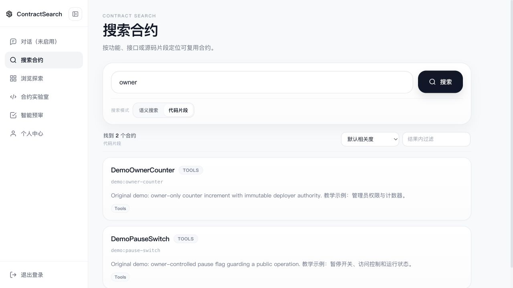

# Validation and evaluation

Validation date: **2026-10-09**. These are engineering checks, not a comparative
model-quality study.

## Repeatable commands

```bash
mvn -f backend/pom.xml test
npm --prefix frontend test
npm --prefix frontend run build
npm --prefix contract-runtime-service test
npm --prefix lean-runtime-service test
python3 -m unittest discover -s scripts/tests -v
python3 scripts/check-public-content.py
python3 scripts/check-doc-links.py
node scripts/agentic-rag/run-eval.mjs --check
```

The database and live-tool integration tests are opt-in and must target a
disposable database. See [backend instructions](../development/backend.md).

## Observed results

| Check | Scope and observation |
|---|---|
| Java | Active reactor builds/packages; gateway, business and Agent tests pass; live dependencies are explicitly gated |
| Database bootstrap | Fresh PostgreSQL 18.3 / pg_search 0.23.0 / pgvector 0.8.1; repeated schema/seed leaves three samples and one group |
| Search | Real English source BM25 and Chinese description BM25 queries return the expected samples |
| Agent migrations | V1–V6 applied in fresh and live-clone test schemas; repeated migrate has no changes |
| Knowledge bootstrap | Two real imports both retain 3 sources / 3 documents / 6 indexed chunks; orphan, missing-index and duplicate checks return zero |
| Agent tool integration | Real contract search → read-only detail → runtime compilation passes without a model call |
| Frontend | 13 behavior tests pass; production build succeeds; Monaco emits a size warning |
| Contract runtime | Three tests pass, including real compilation, deployment, state write/read and session expiry |
| Lean wrapper | Four tests pass with an injected executor; no real Lean toolchain is claimed |
| Publication/demo scripts | 29 behavior tests pass, including checked ZIP export; current public-file privacy scan and local documentation links pass |
| Discovery callback | Three tests pass against the installed Python 3.11 environment; full fresh dependency installation is not claimed |
| Basic API workflow | Registration, login, BM25, detail, real compilation and blocked import verified against the local demo |
| Docker demonstration | All four application images built; Compose database/runtime healthy; the same API smoke passes through Nginx on loopback 8080 |
| Browser workflow | Actual UI import → compile → local deployment → increment → count returns 1; screenshots use synthetic data |

Any additional verification performed for a release should record the commit,
dependency versions, commands and whether external services were involved.
Do not publish raw logs or account/token payloads.

The Docker build was run from a temporary ASCII source directory because the
local BuildKit version rejected a non-ASCII checkout path. An isolated anonymous
Docker configuration avoided a stalled local credential helper; no global Docker
configuration was changed. Linux installation also exposed and verified the fix
for Ganache's optional macOS-only `fsevents` lock entry.

## Actual interface samples




These are application screenshots, not mockups. They show synthetic source and
accounts and do not claim a successful live Agent answer.

## Historical material

The [seed cases](../agentic-rag/eval/golden-set-v0.1.json) are not human-graded.
The [90-row harness summary](../agentic-rag/eval/results/phase1-harness.summary.json)
explicitly uses a mock adapter and `qualityEvaluation: false`. It must not be
reported as a Direct GLM / Naive RAG / Agentic RAG quality comparison.

Archived delivery reports contain earlier real-run observations, with their
original dates and limitations. They do not certify the current environment.

## A future quality study

Freeze a clearly licensed corpus and a human-reviewed bilingual query set.
Compare methods using the same corpus, provider/model settings and task budget.
Report retrieval relevance, source support, task completion/abstention, latency
and cost, including failures and sample size. Keep private prompts and source
materials out of the published dataset.
